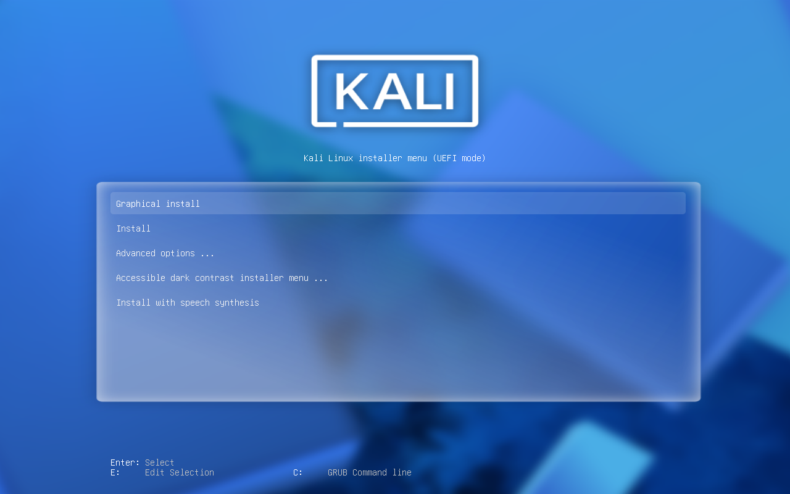
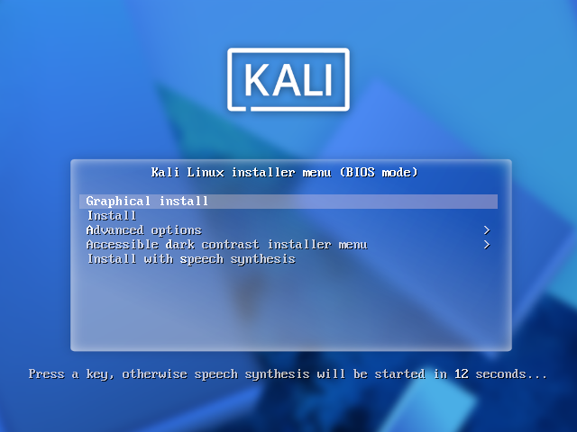
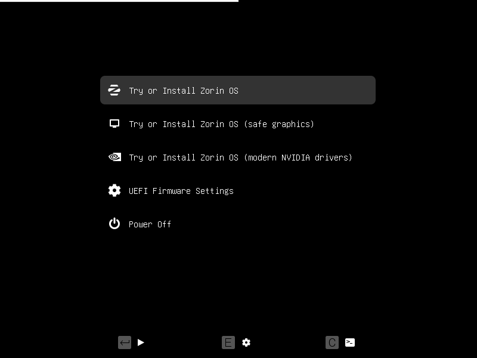
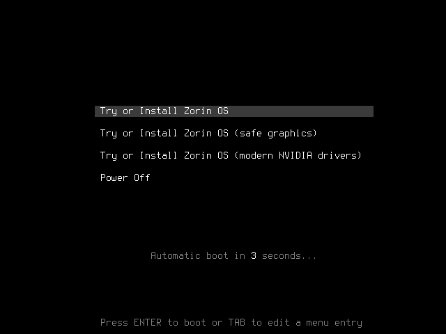
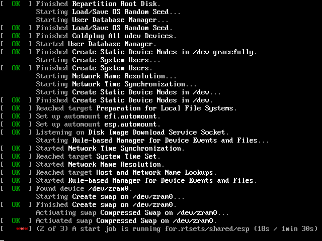
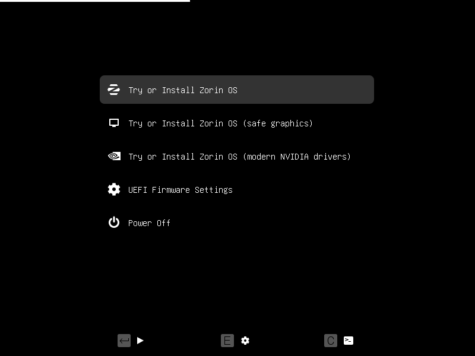

# Testes com imagens reais — 21/10/2026

## Português (Brasil)

Foram usados arquivos regulares como discos virtuais QEMU, com as imagens de
origem somente leitura e sem dispositivos físicos ou rede conectados aos guests.
O helper original 0.3.3 foi usado para as gravações RAW grandes; a correção 0.3.4
atua na cópia de árvores extraídas e no preflight da persistência. O helper
corrigido passou nos 40 cenários de backend e na mídia persistente real do Zorin.

| Imagem | Gravação e integridade | Firmware observado |
| --- | --- | --- |
| SteamOS / Steam Deck recovery 3.8.14 (`.img.bz2`) | Descompressão integral com CRC válido; 8.120.172.544 bytes gravados e comparados, hash SHA-256 independente e CRCs GPT válidos | Consulte o registro e a captura UEFI abaixo |
| Kali Linux 2026.2 Installer amd64 | SHA-256 oficial corresponde; 4.802.531.328 bytes gravados e comparados; SHA-256 independente do destino e CRCs GPT válidos | Menu oficial do instalador em BIOS e UEFI |
| Zorin OS 18.1 Core 64-bit | SHA-256 oficial corresponde; 3.909.091.328 bytes gravados e comparados; SHA-256 independente do destino e CRCs GPT válidos | GRUB e tela de carregamento em BIOS e UEFI |

O cache do dispositivo virtual foi invalidado antes da leitura posterior.
No SteamOS, a verificação automática inicial da VM foi interrompida devido ao
volume de progresso enviado ao console serial. O SHA-256 integral do destino
correspondeu ao conteúdo expandido; em seguida, o comando `verify` do helper
0.3.4 comparou todos os bytes com uma referência expandida nativamente do bzip2,
com CRC e SHA-256 conferidos, destino somente leitura e progresso resumido.
Uma tentativa separada com origem ainda comprimida foi interrompida e não
conta como aprovação integral. Não se afirma
que o job automático original do SteamOS tenha emitido `COMPLETE`.
Para SteamOS, há SHA-256 local do arquivo comprimido e do conteúdo expandido;
não foi encontrado um digest oficial publicado na listagem da Valve. CRC de
bzip2 e comparação com o arquivo local não equivalem a uma assinatura do fornecedor.

### Falha encontrada e corrigida no Zorin

A persistência falhava ao calcular a árvore da ISO devido aos links internos
`dists/stable -> noble` e `dists/unstable -> noble`. A versão 0.3.4 os materializa
como diretórios/arquivos no destino. O caminho canônico deve permanecer na
árvore da origem; ciclos, links quebrados, caminhos externos e arquivos especiais
são recusados. A análise e a capacidade expandida são conferidas antes de
particionar o destino de persistência.

O teste real corrigido concluiu a cópia NTFS, uma área ext4 `casper-rw` de 1 GiB,
o argumento `persistent` no GRUB, o manifesto de validação e o `e2fsck` sem erros.
O initramfs da própria ISO confirma a compatibilidade com esse rótulo legado.
Isso comprova a configuração, não uma sessão live que preservou arquivos após
reiniciar. A gravação RAW continua preservando rótulos e partições da imagem.

### Regressão e interface

- 17 suítes nativas aprovadas, sem falhas.
- Sete casos novos de árvore/links aprovados também com ASan/UBSan.
- 40 cenários em VM e três boots sintéticos mínimos aprovados com o helper corrigido.
- Seleção real das três imagens na GUI, padrão RAW/DD, controles de layout
  desabilitados e conferência posterior disponível.
- Notas 0.3.4, créditos e conclusão de operações conferidos em pt_BR, en, es e zh_CN.

As capturas demonstram somente as etapas explicitamente descritas. Secure Boot
estava desativado. Não houve instalação completa das distribuições, recuperação
de um Steam Deck físico nem qualificação universal de hardware/ISOs.

## English

The tests used regular files as disposable QEMU USB disks, read-only image inputs,
no physical disks and no guest network. All three large RAW payloads were written,
read back after cache invalidation and checked with an independent target SHA-256.
Kali and Zorin matched their official checksums; SteamOS passed the full bzip2 CRC
and local expanded-image hash checks, without a verified vendor-published digest.

The SteamOS VM's original automatic verification was interrupted because serial
progress output dominated its runtime. Its full independent target hash matched;
the production 0.3.4 `verify` command then compared every byte against a separately
native-expanded, CRC/hash-checked reference on a read-only target. Only progress
output was summarized. A separate still-compressed in-VM probe was interrupted
and is not counted as a full pass.
The original SteamOS job did not emit a final `COMPLETE` marker.

The original 0.3.3 helper performed those large RAW writes. Version 0.3.4 fixes
extracted ISO-tree aliases and persistence preflight. Its helper passed 17 native
suites, seven new tree cases with ASan/UBSan, 40 backend VM cases and three minimal
synthetic firmware boots. The real Zorin persistent-media job now completes,
including NTFS, a 1 GiB ext4 casper-rw area, GRUB persistence arguments, the runtime
validation manifest and a clean filesystem check.

Firmware evidence covers only the recorded menus, splash or validation stages.
Secure Boot was disabled. Full desktop installs, physical Steam Deck recovery and
live persistence across reboots remain outside this validation scope.

## Evidências / Evidence

[Dados e hashes / Data and hashes](evidence/linux/tuxflash/real-images-2026-10-21/validation.json)

### kali — UEFI

Official Kali installer menu (UEFI).

### kali — BIOS

Official Kali installer menu (BIOS).

### zorin — UEFI

Zorin GRUB menu; subsequent frame also showed the OS splash.

### zorin — BIOS

Zorin GRUB menu; subsequent frame also showed the OS splash.

### steam — UEFI

UEFI chainloader, Linux kernel and systemd initialization observed with virtio graphics. The VM later waited for /.rtests/shared/esp; recovery desktop and Steam Deck hardware recovery remain unqualified.

### zorin-persistent-fixed — UEFI

NTFS UEFI loader, media validator (886 files, zero failed), then Zorin GRUB menu. Desktop and persistence after reboot not tested.

Fontes / Sources: [Valve recovery index](https://steamdeck-images.steamos.cloud/recovery/), [Kali SHA256SUMS](https://cdimage.kali.org/kali-2026.2/SHA256SUMS), [Zorin official checksums](https://help.zorin.com/docs/getting-started/check-the-integrity-of-your-copy-of-zorin-os/).
