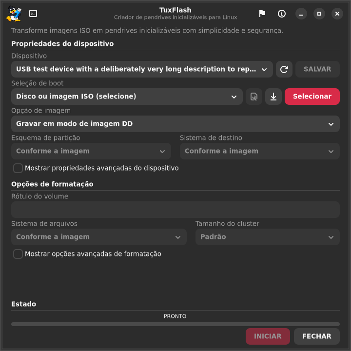

# TuxFlash 0.3.6 — revisão e validação / review and validation

Publicação / Release: **2026-10-28**. Evidências de execução / Test evidence: **2026-10-21**, com recompilação e regressões da integração em **2026-10-28**.

## Português Brasil

A versão 0.3.6 corrige o dimensionamento da janela e reforça o cancelamento,
a leitura de imagens comprimidas e a captura de dispositivos. Mantém os créditos,
o ícone e os quatro idiomas do projeto, sob GPL-3.0-or-later.

### Alterações

- Janela inicial de 720 × 760, limitada à área disponível do monitor; campos compactos, textos longos abreviados com dica e mensagens de estado que quebram linha.
- Estado, progresso e botões Iniciar/Fechar ficam num rodapé fixo. Não há barras de rolagem visíveis nem transbordamento horizontal. O formulário básico cabe em 1024 × 768 nos quatro idiomas; em telas menores ou com opções avançadas, o conteúdo continua acessível por roda, toque e teclado.
- Cancelamento por um canal privado entre a interface/CLI e o helper elevado. Isso permite interromper o helper mesmo quando o usuário comum não pode enviar sinais ao processo root. O parser da opção interna também possui teste com prazo limite.
- A origem comprimida é aberta e validada uma única vez e fornecida ao descompressor pelo descritor. O helper recusa links simbólicos diretos, arquivos vazios e origens que não sejam arquivos regulares; caminhos canônicos resolvidos pela interface continuam disponíveis.
- A captura reserva a saída exclusivamente após validar e abrir a origem. VHD/VHDX usam descritores fixados; substituições do caminho não redirecionam a gravação para outro arquivo. A conclusão verifica sincronização e identidade da saída.
- Escritas interrompidas respeitam o cancelamento, em vez de reiniciar indefinidamente. As verificações existentes de disco do sistema, capacidade, identidade e montagem protegida permanecem no backend compartilhado.

O código publicado entre as candidatas foi conciliado antes do lançamento: lançador único, instalação do atalho com pré-validação, estado de cancelamento da interface e regressões adicionais foram preservados. O teste entre UIDs comprova o transporte até root; uma nova autenticação Polkit completa nesta revisão permanece fora do alcance desse ensaio.

### Resultados reproduzíveis

| Verificação | Resultado e alcance |
| --- | --- |
| Meson nativo | 21 suítes aprovadas, nenhuma falha |
| Interface GTK | 12 configurações com bibliotecas nativas e 12 com as bibliotecas privadas do portátil; quatro idiomas × 800×600, 1024×768 e 1920×1080; formulário básico e avançado em cada configuração |
| ASan/UBSan do helper | 31 casos sem privilégios aprovados: 21 de verificação e 10 de E/S; um caso entre UIDs é omitido no host e executado na VM |
| Backend em VM descartável | 45 casos aprovados, nenhuma falha; inclui cancelamento de root por emissor UID 1000, proteções de destino, imagens comprimidas, captura e provisionamento Windows sintético |
| Núcleo de hashes | Verificações independentes de plataforma/hash e sanitização concluídas |

As regressões exercitam cancelamento de leitura/escrita bloqueada, troca de caminho
com quatro descompressores e preservação de um arquivo vítima durante captura
VHD/VHDX. Nenhum dispositivo físico foi anexado à VM ou regravado nesta revisão.

O helper final tem SHA-256:
`d0482e84a284898fc04cc11d5d0955a3019df4e5c19c95184893cc8775959d50`.
O executável copiado para a árvore da VM possui o mesmo hash. Os resultados
sanitizados estão em [validation.json](evidence/linux/tuxflash/stability-0.3.6/validation.json),
[nativo](evidence/linux/tuxflash/stability-0.3.6/native-results.json),
[VM](evidence/linux/tuxflash/stability-0.3.6/backend-vm.log),
[sanitizadores](evidence/linux/tuxflash/stability-0.3.6/helper-sanitizers.tap),
[interface nativa](evidence/linux/tuxflash/stability-0.3.6/gui-native.json) e
[interface portátil](evidence/linux/tuxflash/stability-0.3.6/gui-portable.json).
São resultados resumidos, sem ambiente, caminhos pessoais ou identificadores de dispositivos.

### Controle adicional do Windows 10

Um helper intermediário da candidata 0.3.6 criou um disco virtual regular de 15,5 GB;
906 arquivos foram comparados após invalidação do cache e o FAT foi conferido.
O hash e o alcance exato estão no [controle Windows](evidence/linux/tuxflash/stability-0.3.6/windows-control.json).
Esse ensaio ocorreu antes das alterações finais do canal de cancelamento e da janela;
portanto, não qualifica o binário final com essa ISO real.

Em UEFI/TCG, com 1536 MiB, duas CPUs virtuais, mídia virtual somente leitura,
sem rede, discos do host ou Secure Boot, a tela de idioma/teclado do instalador
continuou visível em [180 segundos](evidence/linux/tuxflash/stability-0.3.6/windows-control-180s.png)
e [300 segundos](evidence/linux/tuxflash/stability-0.3.6/windows-control-300s.png).
O controle não reproduziu a captura azul anterior do pendrive físico e não
estabelece sua causa ou correção. Não foram obtidos logs do WinPE nem concluída
uma instalação do Windows. A evidência física anterior mantém seu próprio alcance.

### Limites e próxima qualificação

Ainda faltam qualificar a imagem completa comprimida de SteamOS com o binário final,
a recuperação em Steam Deck físico, persistência entre reinicializações, Secure Boot,
Windows To Go até o desktop e uma matriz maior de distribuições/arquiteturas.
As aprovações acima não garantem ausência de todo erro, compatibilidade com qualquer
ISO/Linux ou equivalência integral ao Rufus. Veja a [matriz de compatibilidade](COMPATIBILIDADE.md).
Feche e reabra uma instância antiga para carregar o novo dimensionamento.

## English

Version 0.3.6 fixes window sizing and strengthens cancellation, compressed input
and device capture. It retains the project credits, icon and four languages under
GPL-3.0-or-later.

The 720 × 760 initial window is constrained to the monitor. Compact fields,
ellipsized choices with tooltips and wrapped status text prevent horizontal
overflow. A fixed footer keeps status, progress and Start/Close visible. There
are no visible scrollbars. The basic form fits 1024 × 768 in all four languages;
smaller screens and expanded options remain scrollable by wheel, touch or keyboard.

A private control pipe lets the GUI/CLI cancel the elevated helper across UIDs.
A bounded parser regression covers the internal option. Compressed input is
validated once and decoded from its pinned descriptor. The helper rejects direct
symlinks, empty files and nonregular input. Capture reserves its output exclusively
after source validation; VHD/VHDX tools use pinned descriptors, and completion checks
output synchronization and identity. Interrupted writes honor cancellation.
Existing shared-backend target and system-disk protections remain in place.

The intervening candidate changes were reconciled before release, preserving the unified launcher, safe shortcut preflight, cancellation-state UI and extra regressions. Cross-UID tests prove transport to root; a fresh complete Polkit authentication in this revision remains outside that test scope.

All **21 native suites**, **45 disposable-VM backend cases** and **24 GUI
configurations** passed. Each GUI configuration covers basic and expanded forms:
four languages at 800×600, 1024×768 and 1920×1080, with native and portable private
libraries. ASan/UBSan passed **31 nonprivileged helper cases** (21 verification,
10 I/O); the root-only cross-UID case was skipped on the host and passed in the VM.
Independent hash/platform checks and hash sanitization also completed.
The final helper fingerprint and sanitized evidence are linked above. No physical
USB was rewritten for this review.

An **intermediate** 0.3.6 helper created Windows 10 media on a regular virtual disk:
906 files matched after cache invalidation and FAT checks passed. This predates
the final control-channel/UI changes and does not qualify the final binary with
that real ISO. A read-only UEFI/TCG control (1536 MiB, two virtual CPUs, no host
disks/network, Secure Boot off) still showed Windows Setup's language/keyboard
screen at 180 and 300 seconds. It did not reproduce the earlier physical-USB blue
capture; its cause and resolution remain unestablished. No WinPE logs or complete
Windows installation were obtained.

Full-size compressed SteamOS qualification with the final binary, physical Steam
Deck recovery, persistence across reboots, Secure Boot, Windows To Go desktop and
a broader distribution/architecture matrix remain open. These results do not
establish universal ISO/Linux support, complete Rufus parity or absence of every
error. Close and reopen an older running instance to load the new geometry.
