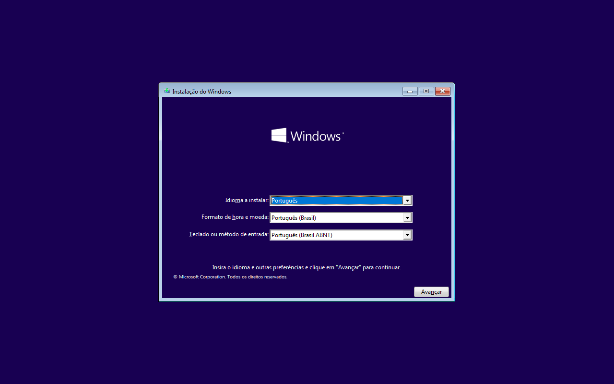

# Pendrive Windows 10 e novas ISOs — 21/10/2026

## Português (Brasil)

**Instalador Windows 10 existente preservado e conferido. Debian 13.7 e Ubuntu
26.04.1 passaram na gravação e leitura integral em discos virtuais com o helper
TuxFlash 0.3.5.** Esta revisão acrescenta evidência; não altera o código do aplicativo.

### Pendrive físico

| Teste | Resultado |
| --- | --- |
| Descoberta pela aplicação | USB removível de 15,5 GB identificado |
| Rótulo / estrutura observada pelo sistema | WINDOWS 10 / GPT com uma partição FAT32 |
| Comparação com a extração de referência | 906 arquivos, 4.387.198.448 bytes, nenhum ausente ou divergente de tamanho/SHA-256 |
| Arquivo adicional | `System Volume Information/IndexerVolumeGuid`, 76 bytes; conteúdo/identificador não publicado |
| `boot.wim` | Verificação interna pelo wimlib aprovada; cerca de 1017 MiB de dados descomprimidos conferidos |
| `install.esd` | Metadados e catálogo de imagens lidos com sucesso |
| BCD BIOS e UEFI | Dois hives lidos em modo somente leitura, nove objetos em cada um |
| Boot UEFI do USB físico em VM | Instalador Windows 10 na seleção de idioma, região e teclado |
| Gravação / apagamento do USB | Não realizados |

A comparação inicial usou a montagem FAT32 **somente leitura**, autorizada pelo
serviço de discos da sessão. Foram solicitados descartes de cache por arquivo
com `POSIX_FADV_DONTNEED`; isso não equivale a comprovar invalidação do cache de
blocos com `BLKFLSBUF`. A ISO de referência coincidiu novamente com o SHA-256
histórico `1119a177f3a4fc8a8fe6c1c1ef59afcf94ed6af0adcff445993ac4fdddd13768`.
O manifesto vem da extração independente de 7-Zip registrada na validação anterior.

A conferência administrativa também passou: GPT primário e de backup com CRC
válido, tabelas de partições iguais, `fsck.vfat -n` com saída zero, cache de blocos
invalidado e nova comparação dos 906 arquivos. Os metadados GPT/boot permaneceram iguais.

#### Boot UEFI lendo o pendrive físico

**O boot chegou à tela de seleção de idioma, região e teclado do instalador
Windows 10; a estabilidade após essa etapa permanece pendente.** A captura foi
inspecionada visualmente. O QEMU leu diretamente o USB existente por um descritor aberto somente para leitura e exclusivamente;
o modo somente leitura também foi confirmado pela interface QMP do emulador.
O processo do QEMU executou como usuário comum, sem capabilities e sem grupo de
acesso a discos. Discos internos e rede não foram disponibilizados à VM. A VM usou 1536 MiB
de RAM, duas vCPUs e emulação TCG.

Depois de encerrar o emulador, as regiões inicial e final de 1 MiB do USB
permaneceram idênticas e a partição voltou a ser montada somente para leitura.
O rótulo continuou WINDOWS 10. Esta execução comprova o boot do USB físico em
**firmware UEFI virtualizado**; não é uma nova inicialização pelo firmware do
computador, nem uma instalação completa do Windows. Secure Boot estava desligado.

A captura de 120 s mostra a seleção de idioma. Na captura posterior de 180 s,
a janela do instalador não estava visível; havia apenas o fundo azul. Portanto,
o resultado comprova que o boot chegou à interface, mas **não qualifica sua
permanência estável nem o avanço da instalação**. A causa dessa mudança não foi
determinada. As quatro capturas estão preservadas na pasta de evidências.

[Registro do boot e proteções verificadas](evidence/linux/tuxflash/usb-and-isos-2026-10-21/physical-usb-uefi-boot.json).

A mídia física foi criada em uma versão anterior e seu boot físico já havia
sido confirmado pelo usuário. Esta conferência valida o conteúdo existente;
nenhuma nova instalação Windows no SSD do computador foi iniciada.

### Novas imagens

| Imagem | Tamanho | Escrita / leitura / SHA-256 independente | Firmware em VM |
| --- | ---: | --- | --- |
| Debian 13.7.0 netinst amd64 | 792.723.456 bytes | Aprovados | Menus BIOS e UEFI; instalador gráfico UEFI na seleção de idioma |
| Ubuntu 26.04.1 Desktop amd64 | 6.482.409.472 bytes | Aprovados | Menus GRUB BIOS e UEFI; desktop completo não qualificado |

As imagens coincidiram com os SHA-256 publicados por
[Debian](https://cdimage.debian.org/debian-cd/current/amd64/iso-cd/SHA256SUMS) e
[Ubuntu](https://releases.ubuntu.com/26.04.1/SHA256SUMS), obtidos por HTTPS.
As assinaturas PGP desses arquivos não foram verificadas nesta execução.
Os valores exatos e resultados do probe estão em [new-images.json](evidence/linux/tuxflash/usb-and-isos-2026-10-21/new-images.json).

O helper real escreveu cada imagem em um **arquivo de disco virtual de 16 GiB**,
fez flush e conferência com invalidação de cache dentro do guest. Uma segunda
comparação SHA-256 do payload foi executada independentemente no host.
Os boots seguintes usaram snapshots desses arquivos, sem discos internos do
host nem rede. Secure Boot estava desligado. Não foi feita instalação completa,
sessão persistente ou teste físico de gravação de Debian/Ubuntu.

O probe reconheceu Debian netinst sem persistência e Ubuntu como imagem com
persistência disponível. Isso descreve a capacidade detectada; não comprova
preservação de dados de uma sessão Ubuntu após reiniciar.

### Capturas

[Resultado estruturado](evidence/linux/tuxflash/usb-and-isos-2026-10-21/validation.json).
Os registros públicos omitem caminhos pessoais, números de série, nomes do
computador e valores dos identificadores de volume.

## English

The existing Windows 10 USB installer was preserved. All **906 original files
(4,387,198,448 bytes)** match the independent extraction reference by size and
SHA-256. The only additional file is a 76-byte Windows indexing metadata file;
its contents/identifier are not published. Internal `boot.wim` verification,
`install.esd` metadata reading and read-only parsing of both nine-object BCD
stores passed. The volume label remains **WINDOWS 10**.

The initial file comparison used a read-only desktop mount and per-file cache
discard advisories; it does not by itself prove block-cache invalidation.
Administrative checks also passed: valid primary/backup GPT CRCs and matching
arrays, a zero-exit read-only FAT check, block-cache invalidation and another
complete 906-file comparison. GPT/boot metadata remained unchanged.

**UEFI VM boot reading the physical USB reached Windows 10 Setup's language,
region and keyboard selection screen**, confirmed by visual review.
The USB was opened exclusively with a read-only descriptor; QMP independently
confirmed read-only access. QEMU ran as an ordinary user with zero effective
capabilities and no disk-access group. No host internal disks or network were
attached. The VM used 1536 MiB of RAM, two vCPUs and TCG emulation. After shutdown,
the first and last 1 MiB remained unchanged and the partition was remounted read-only with its WINDOWS 10 label preserved.
The screenshot and structured boot record are linked above. This is virtualized
UEFI boot from the real USB, not a new host-firmware boot or a complete Windows
installation. Secure Boot was disabled.

The 120 s capture shows the language-selection window. The later 180 s capture
shows only a blue background without that window. This proves that boot reached
the interface, but **does not qualify sustained installer readiness or further
installation steps**. The cause of this change was not determined. All four
captures are preserved in the evidence directory.

Debian 13.7 netinst and Ubuntu 26.04.1 Desktop match their official HTTPS
checksum lists. Both passed full RAW writing, helper read-back and independent
payload SHA-256 comparisons using regular virtual disk files. BIOS/UEFI menus
were visually confirmed; Debian’s UEFI graphical installer reached language
selection. Ubuntu’s complete live desktop was not qualified. Network and host
internal disks were absent; Secure Boot was off. No full installation,
persistence across reboots or physical Linux USB write was performed.

The Windows USB was created by an earlier version; this is fresh validation of
its existing contents, not a new physical write with 0.3.5. No application-code
changes were needed by these tests. See the linked evidence and screenshots.
